<p align="center"></p>

# GraamCredit

**A clearer path to credit.**

[Quick start](#quick-start) · [Backend guide](graamcredit-backend/README.md)

<table><tr><td width="33%" valign="top"><h3>Explore eligibility</h3><p>Submit a profile for a model-based assessment.</p></td><td width="33%" valign="top"><h3>Understand the flow</h3><p>Application forms, results, and an admin overview.</p></td><td width="33%" valign="top"><h3>Try bank-data consent</h3><p>Simulated Account Aggregator flow for demos.</p></td></tr></table>

A rural microloan eligibility prototype with a static frontend and a Python API. The model trains on **synthetic data**; the Account Aggregator integration uses a **mock consent and bank-data flow** by default.

## Experience

| Surface | Purpose |
| :--- | :--- |
| Landing and explainer pages | Introduce eligibility checks |
| Application form | Collect inputs for a model-based assessment |
| Results | Display calculated eligibility |
| Admin page | View application information |
| Contact form | Send messages through the API |

## Quick start

Clone this repository and start the backend:

```bash
git clone https://github.com/begoneeraj/GraamCredit.git
cd GraamCredit/graamcredit-backend
python -m venv .venv
# Windows PowerShell: .venv\Scripts\Activate.ps1
# macOS/Linux: source .venv/bin/activate
pip install -r requirements.txt
# Copy .env.example to .env and configure your own values.
python ml/train.py
python main.py
```

The API runs at **http://localhost:8000**; interactive docs are at **http://localhost:8000/docs**. Multi-model training can take time.

In a second terminal, serve the repository root:

```bash
python -m http.server 5500
```

Open **http://localhost:5500**. Before testing locally, change the existing assignment in `config.js`:

```javascript
window.GRAAMCREDIT_API = 'http://127.0.0.1:8000';
```

The checked-in frontend targets a hosted backend. Local allowed origins are listed in the backend environment template.

## Architecture

```text
HTML / CSS / JavaScript
        → FastAPI routes
        → SQLAlchemy + SQLite
        → scikit-learn eligibility model
        → optional SMTP notifications
```

| Layer | Technology |
| :--- | :--- |
| Frontend | HTML, CSS, JavaScript |
| API | Python, FastAPI, Pydantic |
| Persistence | SQLAlchemy, SQLite |
| Model training | scikit-learn, cross-validation, ensembles |
| Demo bank data | Mock Account Aggregator routes |

## Development notes

- Generate `graamcredit-backend/ml/model.pkl` before inference.
- Configure database, CORS, SMTP, and demo bank-data options using `graamcredit-backend/.env.example`.
- Synthetic-data metrics demonstrate the pipeline; they do not establish real-world lending performance.
- See the [backend guide](graamcredit-backend/README.md) for endpoints and configuration.

## Repository map

```text
index.html, form.html, result.html   Main frontend flow
admin.html                          Admin interface
config.js                           API base URL
graamcredit-backend/                 API, models, ML, configuration
```
